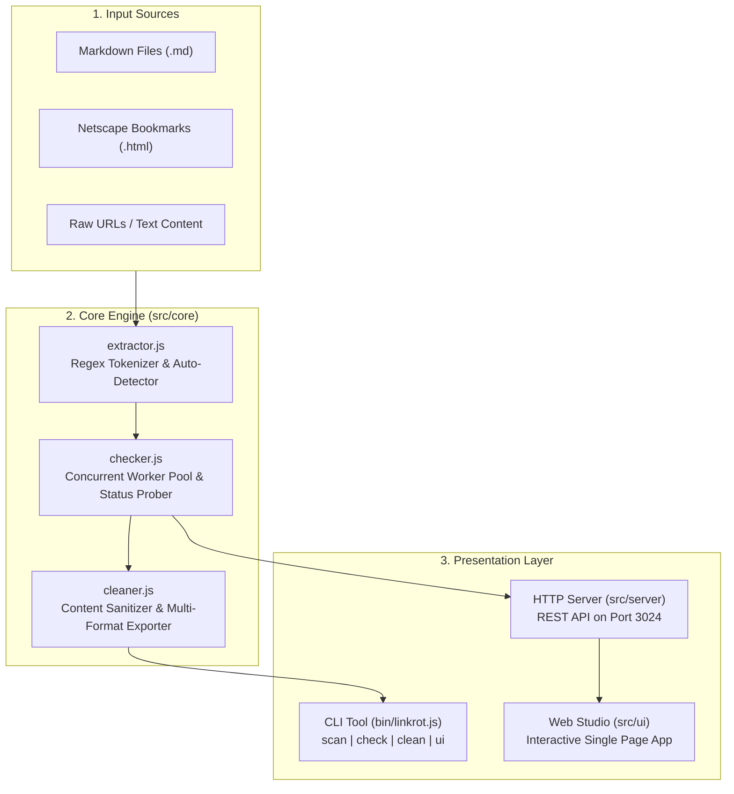

# LinkRot-Scanner 🔗🔍

> High-throughput zero-dependency link rot detector, HTML bookmark auditor, and Markdown 404 URL scanner with an interactive Web Studio dashboard.

[](https://opensource.org/licenses/MIT)
[](https://nodejs.org/)
[](package.json)
[](test)
[](http://localhost:3024)

---

## 🌟 Overview

**LinkRot-Scanner** is a developer tool engineered to eliminate dead links, obsolete redirects, and broken external resources across documentation sites, README files, Markdown knowledge bases, and browser bookmark exports.

Built from scratch using **pure Node.js standard libraries** (`http`, `https`, `url`, `fs`, `path`, `node:test`), it requires **zero external npm packages** while offering concurrent worker pooling, automatic fallback from `HEAD` to `GET`, redirect chain inspection, dead link removal, multi-format reporting, and a full-featured browser-based Web Studio.

---

## 🚀 Key Features

- 🌐 **Multi-Source URL Extraction**:
  - **Markdown Documents**: Parses standard markdown links `[Title](url)`, autolinks `<https://...>`, and reference definitions `[ref]: url`.
  - **Browser Bookmarks**: Ingests Netscape bookmark files exported from Google Chrome, Mozilla Firefox, Brave, and Apple Safari (`<DT><A HREF="...">Title</A>`).
  - **Plain Text & Code**: Extracts raw `http://` and `https://` URLs from text logs, source code, and configuration files.

- ⚡ **Concurrent Worker Pool**:
  - High-throughput scanning with configurable worker limits (`--concurrency <num>`).
  - Native `HEAD` probing with automatic fallback to `GET` for servers that block or disallow `HEAD` requests (e.g. 405 Method Not Allowed or 403 Forbidden).
  - Timeout prevention and resilient socket error handling (DNS errors, connection resets, hung connections).

- 🔄 **Intelligent Redirect Tracking**:
  - Traces `301 Moved Permanently`, `302 Found`, `307 Temporary Redirect`, and `308 Permanent Redirect`.
  - Captures the terminal destination URL while guarding against infinite redirect loops.

- 🧹 **Automated File Sanitation & Cleaning**:
  - Cleans broken links directly from source files.
  - Three customizable removal strategies: complete line deletion, strike-through (`~~broken~~`), or HTML commenting (`<!-- [BROKEN LINK]: ... -->`).

- 📊 **Multi-Format Audit Reports**:
  - Exports comprehensive health audit summaries to **Markdown tables**, **CSV spreadsheets**, and structured **JSON payloads**.

- 🖥️ **Interactive Web Studio**:
  - Local graphical dashboard served on **port 3024**.
  - Live progress bars, health scores, real-time filtering (All, Dead, Redirects, Alive), latency monitoring, and one-click sanitization export.

- 🛡️ **Zero External Dependencies & Strict Security**:
  - No bloated runtime dependencies.
  - Hardened static file delivery with path-traversal mitigation against directory escape attempts.

---

## 🏗️ Architecture



---

## 📦 Installation & Setup

Clone the repository and run directly with Node.js 18+:

```bash
# Clone the repository
git clone https://github.com/mahdyarmonfared/linkrot-scanner.git
cd linkrot-scanner

# Verify zero external dependencies (no npm install required!)
node bin/linkrot.js --help
```

To link globally as a system CLI command:

```bash
npm link
# Now you can run `linkrot` from any folder
linkrot --version
```

---

## 💻 CLI Usage & Commands

```
  _      _       _    _____           _          _____                                 
 | |    (_)     | |  |  __ \         | |        / ____|                                
 | |     _ _ __ | | _| |__) |___  ___| |_ _____| (___   ___ __ _ _ __  _ __   ___ _ __ 
 | |    | | '_ \| |/ /  _  // _ \/ __| __|______\___ \ / __/ _` | '_ \| '_ \ / _ \ '__|
 | |____| | | | |   <| | \ \ (_) \__ \ |_       ____) | (_| (_| | | | | | | |  __/ |   
 |______|_|_| |_|_|\_\_|  \_\___/|___/\__|     |_____/ \___\__,_|_| |_|_| |_|\___|_|   
                                                                                       
 Usage: linkrot [command] [options]

 Commands:
   scan <file>      Scan a Markdown file, HTML bookmark export, or text file for dead links
   check <url>      Quickly check the HTTP health of a single URL
   clean <file>     Remove dead links from a file and produce a sanitized output file
   ui               Launch the interactive Web Studio in your browser (Port 3024)
   version          Show LinkRot-Scanner version
   help             Show this help information

 Options:
   --concurrency <n>   Concurrent HTTP requests (default: 5)
   --timeout <ms>      Request timeout in milliseconds (default: 6000)
   --format <fmt>      Output report format: markdown, csv, or json (default: markdown)
   --output <file>     Write audit report or cleaned file to disk
   --port <n>          Port for Web Studio server (default: 3024)
   --unique            Deduplicate duplicate URLs prior to scanning (default: true)
   --no-redirects      Do not follow HTTP redirects
```

### Examples

#### 1. Scan a Markdown file for broken links:
```bash
node bin/linkrot.js scan README.md
```

#### 2. Scan an exported browser bookmark HTML file with 10 concurrent workers:
```bash
node bin/linkrot.js scan bookmarks.html --concurrency 10 --format csv --output bookmarks-report.csv
```

#### 3. Test a single URL with redirect resolution:
```bash
node bin/linkrot.js check https://httpbin.org/status/404
```

#### 4. Clean dead links from a file:
```bash
node bin/linkrot.js clean docs/awesome-list.md --output docs/awesome-list-clean.md
```

#### 5. Launch the Web Studio:
```bash
node bin/linkrot.js ui --port 3024
```

---

## 🖥️ Interactive Web Studio

Launch the built-in Web Studio by running:

```bash
npm start
# or: node bin/linkrot.js ui
```

Then visit **`http://localhost:3024`** in your browser.

### Web Studio Highlights
- **Drag-and-Drop or Paste**: Ingest Markdown content, bookmark HTML, or URL lists.
- **Real-Time Progress & Score**: Live animated progress meter with overall site health percentage.
- **Interactive Data Grid**: Inspect HTTP status codes, latency timings, redirect destinations, and error causes.
- **Instant Clean & Export**: One-click export to download sanitized documents or download audit logs in CSV/Markdown.

---

## 📡 REST API Reference

The embedded Web Studio server provides REST endpoints:

### `POST /api/extract`
Parses links from the provided raw string.
```json
// Request Body
{
  "content": "[Docs](https://example.com)",
  "unique": true
}

// Response
{
  "success": true,
  "total": 1,
  "links": [
    { "url": "https://example.com", "title": "Docs", "line": 1, "source": "markdown-link" }
  ]
}
```

### `POST /api/check-single`
Performs a health check on an individual URL.
```json
// Request Body
{
  "url": "https://example.com",
  "timeout": 5000
}

// Response
{
  "success": true,
  "result": {
    "url": "https://example.com",
    "statusCode": 200,
    "statusText": "OK",
    "category": "alive",
    "latencyMs": 45,
    "redirectUrl": null,
    "error": null
  }
}
```

### `POST /api/scan`
Concurrently scans an array of URLs or raw text content.
```json
// Request Body
{
  "links": ["https://example.com", "https://example.com/broken"],
  "concurrency": 5,
  "timeout": 5000
}
```

### `POST /api/clean`
Removes dead URLs from the source content.
```json
// Request Body
{
  "content": "- [Alive](https://alive.com)\n- [Dead](https://dead.com)",
  "deadUrls": ["https://dead.com"],
  "options": { "strikethrough": false, "commentOut": false }
}
```

---

## 🧪 Test Suite

Run the full automated test suite using Node.js's native test runner:

```bash
npm test
```

### Test Coverage Highlights:
- **`test/extractor.test.js`**: Markdown parsing (inline, reference, autolinks), Netscape bookmark parsing, raw regex extraction, auto-format detector.
- **`test/checker.test.js`**: Native HTTP/HTTPS client checks, 200/404/500 code handling, redirect chains, HEAD-to-GET fallback, timeouts, batch concurrency, progress callback verification.
- **`test/cleaner.test.js`**: Content sanitization (strip, comment out, strike-through) and report generation (Markdown, CSV, JSON).
- **`test/server.test.js`**: REST API endpoints, CORS handling, static asset serving, and path-traversal security verification.

---

## 📁 Repository Structure

```
linkrot-scanner/
├── bin/
│   └── linkrot.js             # CLI binary entrypoint
├── src/
│   ├── cli/
│   │   ├── ansi.js            # Zero-dependency ANSI color helpers
│   │   └── runner.js          # CLI argument parser and execution logic
│   ├── core/
│   │   ├── checker.js         # HTTP/HTTPS status checker and worker pool
│   │   ├── cleaner.js         # Dead link content sanitizer & report exporter
│   │   ├── extractor.js       # Markdown, HTML, and text link parser
│   │   └── index.js           # Core module aggregator
│   ├── server/
│   │   └── server.js          # REST API server & static file security
│   └── ui/
│       ├── app.js             # Web Studio frontend state & API client
│       ├── index.html         # Web Studio dark cinematic UI
│       └── style.css          # Modern responsive styling & glassmorphism
├── test/
│   ├── checker.test.js        # Status checker & batch pool tests
│   ├── cleaner.test.js        # Content sanitizer & report tests
│   ├── extractor.test.js      # URL extraction tests
│   └── server.test.js         # Server API & security tests
├── .gitignore
├── LICENSE                    # MIT License
├── package.json
└── README.md
```

---

## 📄 License

This project is licensed under the **MIT License** - see the [LICENSE](LICENSE) file for details.

Developed with precision by **[Mahdyar Monfared](https://github.com/mahdyarmonfared)**.
